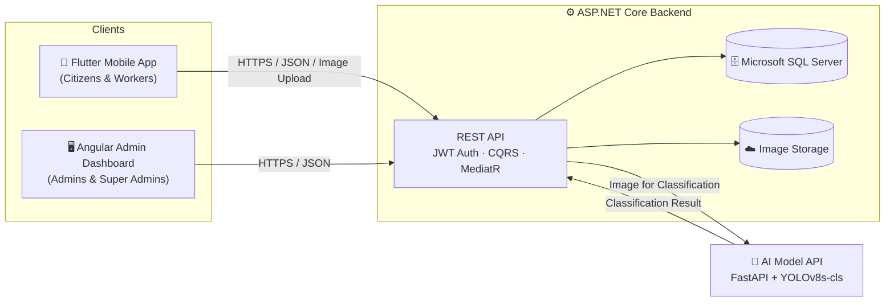

<div align="center">

# 🌿 Yalla Khadra | يلا خضرا

### AI-Powered Smart Waste Management & Recycling Platform

*Report waste. Classify it with AI. Earn rewards. Keep your city green.*


**Graduation Project · Faculty of Computers and Information · Menoufia University · 2025–2026**

</div>

---

## 📑 Table of Contents

- [About the Project](#-about-the-project)
- [Problem Statement](#-problem-statement)
- [Key Features](#-key-features)
- [System Architecture](#-system-architecture)
- [Repositories](#-repositories)
- [Tech Stack](#-tech-stack)
- [AI Waste Classification Model](#-ai-waste-classification-model)
- [Backend & API Overview](#-backend--api-overview)
- [Database Design](#-database-design)
- [User Roles & Permissions](#-user-roles--permissions)
- [Getting Started](#-getting-started)
- [Comparison with Similar Apps](#-comparison-with-similar-apps)
- [Future Work](#-future-work)
- [Team](#-team)
- [Acknowledgments](#-acknowledgments)

---

## 🌍 About the Project

**Yalla Khadra** is a smart waste management ecosystem that connects **citizens**, **sanitation workers**, and **city administrators** on a single platform. Citizens report waste in public areas with a photo and GPS location; the system routes each report to the **nearest available worker**, tracks it until cleanup is complete, and **rewards the citizen with points** that can be redeemed in an **Eco Store**.

An integrated **AI model** identifies the waste type from an image and tells the user whether it is **recyclable**, helping to improve sorting and support recycling efforts.

The platform consists of:

| Component | Description |
|---|---|
| 📱 **Mobile App** | Flutter app for citizens and workers |
| 🖥️ **Admin Dashboard** | Angular web dashboard for admins and super admins |
| ⚙️ **Backend API** | ASP.NET Core (Clean Architecture + CQRS) with SQL Server |
| 🤖 **AI Model API** | YOLOv8s-cls waste classifier served through FastAPI |

---

## ❗ Problem Statement

Urban areas face growing waste management challenges:

- **Slow reporting & response:** citizens lack an easy, fast way to report waste, and reports reach workers late.
- **Weak communication:** citizens can't track whether action was taken on their reports.
- **Low participation:** no incentives or interactive features to encourage community involvement.
- **Inefficient operations:** no centralized system to manage reports, assign tasks, and measure performance.
- **Under-used technology:** modern tools such as AI are rarely applied to waste collection and sorting.

Yalla Khadra addresses each of these with fast reporting, proximity-based task assignment, AI classification, gamification, and a full admin dashboard.

---

## ✨ Key Features

### 👤 Citizens (Mobile App)
- Register / log in with **email & password** or **Google Sign-In**; password reset via verification code
- **Submit waste reports** with images, title, waste type, and location picked on the map
- **Track report status:** `Pending → InProgress → Done`, with **before / after cleanup images**
- **AI Waste Scan:** upload an image to get the waste category and recyclability result, and view scan history
- **Points & rewards:** earn points for validated, completed reports; full points transaction history
- **Leaderboard:** top contributors, filterable by Day / Week / Month / Year
- **Eco Shop:** browse products by category, cart, checkout, order tracking (cancel while `Pending`)
- Profile and complete activity history (reports, orders, transactions)

### 🧹 Workers (Mobile App)
- See the **nearest three available tasks** and search reports within a chosen radius
- **Accept or reject** assigned tasks and view full details on the map
- Upload a **post-cleanup image** and submit final waste type and weight (kg)
- Personal performance dashboard **"My Works"**: completed tasks, average response time, working hours, total cleaned waste (kg)
- Use the same AI scan tool as citizens

### 🛠️ Admins & Super Admins (Web Dashboard)
- View and manage all waste reports with before/after images
- Manage **users** (view, lock, unlock, statistics) and **workers** (add, block, unblock, statistics)
- Manage **Eco Shop** categories, products, and orders (`Pending → Processing → Delivered`)
- Leaderboard analytics and user rankings
- **Super Admin:** manage Admin accounts (add, block, unblock)
- **Analytics dashboard:** report status distribution, users/workers/admins distribution, reports and orders over time, total waste collected, AI scans performed, and e-commerce sales overview

---

## 🏗️ System Architecture



**Backend design principles:** Clean Architecture, CQRS with the Mediator pattern, JWT-based authentication and role-based authorization, containerized with Docker & Docker Compose.

---

## 🔗 Repositories

| Repository | Description | Link |
|---|---|---|
| 🖥️ **Admin Dashboard (Web Client)** | Angular dashboard for admins and super admins | [**YallaKhadra-dashboard-client**](https://github.com/HaazemHassan/YallaKhadra-dashboard-client) |
| 🤖 **AI Model API** | YOLOv8s-cls waste classification service (FastAPI) | [**Yalla-Khadra-AI-Model-API**](https://github.com/ahmedsamy56/Yalla-Khadra-AI-Model-API) |


---

## 🧰 Tech Stack

| Layer | Technologies |
|---|---|
| **Mobile** | Flutter SDK, Dart, Bloc / Flutter Bloc, Hydrated Bloc, GoRouter, Dio, Flutter Secure Storage, Google Sign-In, Flutter Map, Geolocator, LatLong2, Image Picker, Intl / Localizations |
| **Web Dashboard** | Angular, TypeScript, Tailwind CSS, Chart.js, ng2-charts, ngx-toastr |
| **Backend** | ASP.NET Core, Clean Architecture, CQRS & Mediator, JWT, Microsoft SQL Server, Docker, Docker Compose |
| **AI / ML** | Python, PyTorch, Ultralytics YOLOv8s-cls, Kaggle dataset & notebooks, FastAPI |
| **Design** | Figma, Google Stitch |
| **Tools** | VS Code, Visual Studio, NeoVim, Android Virtual Device (AVD) |

---

## 🤖 AI Waste Classification Model

The classifier is an **on-demand decision-support tool**: the user uploads an image of a waste item and gets back the waste category, its recyclability, and recommended handling.

### Model Summary

| Attribute | Value |
|---|---|
| Architecture | **YOLOv8s-cls** (Ultralytics), stacked C2f blocks + FC classification head with softmax |
| Layers / Parameters | 56 layers · 5,096,108 trainable parameters |
| Compute | 12.6 GFLOPs per inference |
| Input | 224 × 224 RGB |
| Output | 12-class probability vector |
| Training strategy | **Transfer learning**, continued from a prior checkpoint (400 epochs, 91.15% accuracy); 156 of 158 weight tensors transferred |
| Optimizer | AdamW, with cosine LR scheduling, MixUp, label smoothing, and early stopping |
| Hyperparameters | max 100 epochs, batch size 32, image size 224 |

### Dataset

- Source: Kaggle garbage classification dataset, **15,515 images across 12 classes**
- **Stratified per-class split** (fixed seed `42` for reproducibility):

| Split | Images | Share |
|---|---|---|
| Train | 10,854 | 69.9% |
| Validation | 2,321 | 15.0% |
| Test | 2,340 | 15.1% |

- The dataset is imbalanced (the largest class, *clothes*, has about 8.8× more samples than the smallest, *brown-glass*).

### Results (held-out test set, 2,340 images)

| Metric | Value |
|---|---|
| **Top-1 Accuracy** | **97.14%** |
| **Top-5 Accuracy** | **99.87%** |
| Improvement over previous stage | 91.15% → 97.14% |

The three glass sub-classes (white, green, brown) are the most confused with each other because of their strong visual similarity.

### Limitations & Planned Improvements
- Mitigate class imbalance (weighted sampling / focal loss)
- Batch inference for faster evaluation
- Automated **ONNX / TFLite** export for on-device mobile inference
- Experiment tracking with Weights & Biases or MLflow

---

## ⚙️ Backend & API Overview

The REST API is organized into the following controllers:

| Module | Responsibility |
|---|---|
| **User API** | Profiles, user management |
| **Authentication API** | Register, login, Google Sign-In, refresh tokens, password reset |
| **Cart API** | Cart operations for the Eco Shop |
| **Order API** | Checkout, order history, status management |
| **Product API** | Product & category management |
| **Waste Report API** | Create / view / track reports, nearby reports |
| **Cleanup Task API** | Assign tasks to workers, complete cleanup operations |

**Notable details**
- **Report status flow:** `Pending (0)` → `InProgress (1)` → `Done (2)`
- **Waste types:** Plastic, Paper, Glass, Metal, Organic, Electronic, Construction, Textile, Mixed
- **Proximity search** uses the **Haversine formula** over latitude/longitude (6-decimal precision)
- **Image uploads:** JPEG / JPG / PNG / GIF, up to 10 MB each and 10 images per report, stored in cloud storage
- **Pagination:** 1-indexed pages, default size 10

---

## 🗄️ Database Design

Microsoft SQL Server, split into five schemas for separation of concerns:

| Schema | Purpose |
|---|---|
| `identity` | Authentication, authorization, user profiles, refresh tokens, verification codes |
| `ecommerce` | Products, carts, orders, categories, shipping |
| `green` | Environmental reports, AI scans, cleanup tasks, images |
| `points` | User reward points and transactions |
| `dbo` | Shared media storage (images) |

---

## 🔐 User Roles & Permissions

| Role | Description | Main Permissions |
|---|---|---|
| **User** | Citizen using the mobile app | Report waste, AI scan, track reports, earn points, shop, leaderboard |
| **Worker** | Cleanup staff | Receive / accept / reject tasks, upload cleanup proof, performance stats |
| **Admin** | System manager | Manage reports, users, workers, eco shop, view analytics |
| **Super Admin** | Highest authority | All Admin privileges + manage Admin accounts |

---

## 🚀 Getting Started

> Each component lives in its own repository. Follow the README in each repo for the exact setup steps. The overview below shows the general flow.

### Prerequisites
- Node.js & Angular CLI (dashboard)
- Flutter SDK (mobile app)
- .NET SDK & SQL Server, or Docker (backend)
- Python 3.9+ (AI API)

### 1. Admin Dashboard

```bash
git clone https://github.com/HaazemHassan/YallaKhadra-dashboard-client
cd YallaKhadra-dashboard-client
npm install
ng serve
```

### 2. AI Model API

```bash
git clone https://github.com/ahmedsamy56/Yalla-Khadra-AI-Model-API
cd Yalla-Khadra-AI-Model-API
pip install -r requirements.txt
uvicorn main:app --reload
```


### 3. Backend (Docker)

```bash
docker compose up -d
```

Then point the dashboard and mobile app to your backend base URL in their environment/config files.

---

## 📊 Comparison with Similar Apps

| Feature | E-Tadweer | Dawar | **Yalla Khadra** |
|---|:---:|:---:|:---:|
| Public / street waste reporting | ❌ | ✅ | ✅ |
| All waste types | ❌ (e-waste only) | ⚠️ (street waste) | ✅ |
| AI waste classification | ❌ | ❌ | ✅ |
| Gamification & leaderboard | ⚠️ Basic | ⚠️ Limited | ✅ |
| Worker task assignment by proximity | ❌ | ⚠️ | ✅ |
| Eco-friendly rewards store | ⚠️ Vouchers | ⚠️ Marketplace | ✅ |
| Full admin analytics dashboard | ❌ | ❌ | ✅ |

---

## 🔭 Future Work

- On-device AI inference (ONNX / TFLite) for offline scanning
- Better accuracy on minority waste classes
- Expansion from a single city to multiple cities and governorates
- Experiment tracking and automated model retraining pipeline
- Real-time notifications for report and task updates

---

## 👥 Team

| Name |
|---|
| **Ahmed Samy** |
| **Hazem Hassan** |
| **Ebrahem Essam** |
| **Sohayb Emad el_din** |

**Supervisor:** Prof. Noura A. Semary
**Institution:** Faculty of Computers and Information, Menoufia University, Egypt
**Academic Year:** 2025–2026

---

## 🙏 Acknowledgments

We thank our supervisor **Prof. Noura A. Semary** for her continuous guidance and support, the faculty members of the Faculty of Computers and Information at Menoufia University, and our families for their patience and encouragement throughout this journey.

---

<div align="center">

**Made with 💚 for cleaner streets and a greener future.**

</div>
